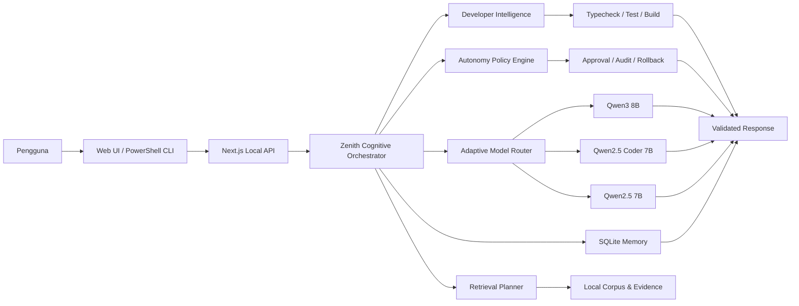

<div align="center">
  

  <br />

  
  
  
  
  
  

  <h3>Asisten AI lokal seimbang yang kini berjalan di profil 4 GB: konteks ringkas, Qwen3 adaptif, mitra keamanan defensif, handler tabel deterministik, controlled coding agent, dan deployment preview/staging.</h3>

  <p>
    <strong>Ollama + Qwen3</strong> • <strong>Next.js</strong> • <strong>FastAPI ML Service</strong> •
    <strong>Web lokal</strong> • <strong>PowerShell CLI</strong> • <strong>Bahasa Indonesia</strong>
  </p>
</div>

---

## Tentang NusaMind Zenith

**NusaMind Zenith N1.6** adalah edisi seimbang dari keluarga NusaMind AI. Zenith menggabungkan reasoning adaptif, kualitas jawaban akademik, controlled build, exact patch, checkpoint, rollback, Git workflow terverifikasi, credential vault, trusted workspace, MCP quarantine, serta deployment preview dan staging.

Release **N1.6 / 1.6.0** melanjutkan fondasi N1.0 dengan **Developer Intelligence N1.1**, **Advanced Autonomy & Deployment N1.2**, **Answer Quality & Academic Response Engine N1.3**, **Adaptive Qwen3 Model Runtime N1.4**, patch **TypeScript 7 N1.4.1**, **Suite Knowledge N1.4.2**, **Table Intelligence N1.5**, **Defensive Security Partner N1.5.1**, dan **Compact Context & profil 4 GB N1.6**.

> NusaMind AI dikembangkan oleh **Muhammad Rafi Priyo** sebagai proyek AI lokal, eksperimen engineering, dan portofolio pribadi. Tidak semua komponen dibuat oleh AI; sebagian dirancang, dikembangkan, diuji, diperbaiki, dan disempurnakan secara manual oleh developer.

## Karakteristik Zenith

- **Seimbang:** reasoning, resource, kualitas jawaban, dan kemampuan engineering berada di tengah antara Swift dan Apex.
- **Adaptive Qwen3:** model utama `qwen3:8b`, model coding `qwen2.5-coder:7b`, dan fallback `qwen2.5:7b`.
- **Thinking adaptif:** aktif pada tugas menengah hingga berat, tetapi tidak dipaksakan untuk pertanyaan sederhana.
- **Controlled build:** edit, exact patch, test, build, checkpoint, dan rollback melalui approval serta policy engine.
- **Bounded autonomy:** maksimal 40 langkah, soft limit 20, runtime 90 menit, dan paralelisme maksimal 2.
- **Preview dan staging deployment:** production deployment tetap tidak tersedia pada Zenith.
- **Local-first:** Ollama, memory, corpus, dan layanan utama berjalan lokal.
- **Web + CLI:** dapat digunakan melalui browser lokal atau PowerShell CLI.

## Developer Intelligence N1.1

- Mode `ASK`, `PLAN`, `BUILD`, `REVIEW`, dan `REPAIR`.
- Project scanner, project map, context ranking, dependency tracing, dan selective LSP.
- Exact patch, checkpoint, rollback, typecheck, test, dan build verification.
- Permission engine per tool/path/agent serta destructive-action gate.
- Maksimal tiga skill dan dua pekerjaan analisis paralel.
- Edit, commit, push, credential, dan deployment tetap tunduk pada approval serta policy.

## Advanced Autonomy & Deployment N1.2

Zenith mengaktifkan autonomy terkontrol untuk development dan staging:

- Git push normal setelah verification dan secret scan.
- Force push hanya memakai `--force-with-lease` dan remote backup branch.
- Controlled destructive action melalui typed action, preview, backup, dan approval.
- Encrypted credential vault dengan reference yang tidak memaparkan nilai secret ke model.
- Trusted external workspace read-write setelah registrasi.
- Unverified MCP tetap quarantine dan hanya dapat berjalan melalui sandbox wrapper.
- Deployment tersedia untuk `preview` dan `staging`; production tetap Apex-only.
- Extended loop maksimal 40 langkah dengan emergency ceiling dan `.nusamind/STOP`.

## Answer Quality & Academic Response Engine N1.3

- Jawaban matematika, fisika, kimia, statistika, dan perhitungan mengikuti urutan **Diketahui → Konsep/Rumus → Penyelesaian → Jawaban akhir → Penjelasan singkat**.
- Jawaban coding memakai tujuan solusi, kode lengkap, cara kerja, contoh input/output, serta edge case ketika relevan.
- Hasil akhir dibuat tegas, tidak berulang, dan tidak menghilangkan langkah penting.
- Code block dijaga tetap utuh dan diberi label bahasa yang sesuai.
- Kedalaman jawaban menyesuaikan pertanyaan dan mode `direct`, `balanced`, `steps`, `detailed`, `academic`, atau `expert`.
- Batas output default Zenith dinaikkan menjadi sekitar **5.200 token**.

## Compact Context & Profil 4 GB N1.6

Profil bawaan kini `4gb`: model kecil, jendela konteks aktif **4.096 token**, dan kompaksi riwayat agar pemrosesan lebih cepat di mesin dengan RAM terbatas.

- **Berapa juta token?** Aktif sekaligus: 4.096. Tersimpan dan bisa dicari ulang: jutaan token di SQLite. Jutaan token aktif di mesin 4 GB tidak mungkin: KV cache `qwen3:1.7b` untuk 1 juta token sekitar **106,81 GiB** (f16), belum termasuk bobot model. Hitungannya ada di [`docs/compact-context-n1.6.md`](docs/compact-context-n1.6.md) dan `npm run context:n16:status`.
- **Kompaksi deterministik** tanpa panggilan model tambahan: pesan terbaru verbatim, ringkasan ekstraktif untuk yang lama, fakta berbobot, dan recall arsip berbasis BM25 yang menaruh hasilnya di pesan terakhir agar cache prompt Ollama tetap terpakai.
- **Prompt ringkas** (±330 token inti aturan menggantikan ±4.700 token); aturan keselamatan dan kejujuran dipertahankan.
- **Tiga profil** lewat `NUSAMIND_HARDWARE_PROFILE`: `4gb` (bawaan), `8gb`, `16gb` (perilaku N1.4 penuh). Jalankan `.\ollama-4gb.bat` untuk profil bawaan.
- **Perbaikan:** `saveSession` tidak lagi menghapus pesan di atas 160 dari database, sehingga arsip tetap utuh.
- **Batas yang jujur:** model 1,7B lebih lemah dari 8B dan kualitasnya belum diukur dengan suite live; tools/agent nonaktif di `4gb`; recall berbasis kata kunci tidak menangkap sinonim; angka memori adalah perkiraan, ukur dengan `ollama ps`; `ollama-4gb.bat` belum diuji di Windows.
- **Peringatan `.env` lama:** baris `OLLAMA_MODEL`, `OLLAMA_NUM_CTX`, `AI_MAX_STEPS`, dan sejenisnya menimpa profil. Hapus atau komentari bila `.env` dibuat dari versi lama.
- Diuji dengan `npm run context:n16:benchmark` (matematika anggaran, validasi profil, properti kompaktor, SQLite dengan arsip ±1,27 juta token, konfigurasi per profil).

## Defensive Security Partner N1.5.1

NusaMind kini dapat menjadi mitra keamanan yang mencari celah pada sistem **milik Anda** dan membantu memperbaikinya.

- **Pemindai statis pasif** dengan 56 aturan untuk JavaScript/TypeScript, Python, shell, PowerShell, batch, Dockerfile, Compose, GitHub Actions, nginx, `sshd_config`, `package.json`, `next.config`, rute API Next.js, dan rahasia tertanam. Tiap temuan membawa lokasi, bukti, alasan, perbaikan, CWE, dan kategori **OWASP Top 10:2025**.
- **Laporan** Markdown, JSON, dan SARIF 2.1.0 (siap untuk GitHub code scanning): `npm run security:audit -- . --format sarif`. Tersedia juga lewat `POST /api/n1/security` dengan token `repo.scan`.
- **Mitra di chat:** pertanyaan keamanan (threat modeling, review kode, hardening, respons insiden, kriptografi) dijawab dengan alur kerja praktisi, dan kode yang Anda tempel ikut dipindai sebagai petunjuk. Tidak ada penolakan berbasis kata kunci.
- **Aman secara desain:** tidak menjalankan kode yang dipindai, tidak mengakses jaringan, tidak mengikuti symlink, tidak membaca `.env` asli, menyamarkan nilai rahasia, dan melaporkan setiap penekanan temuan.
- **Dogfood:** audit pada repo ini menemukan dan memperbaiki `.env` yang belum di-gitignore, path traversal pada server statis hasil generate (dibuktikan sebelum dan sesudah), endpoint reindex yang terbuka saat token kosong, dan security headers dasar.
- **Jujur soal batas:** berbasis pola sehingga ada false positive dan negative, tanpa pemeriksaan CVE (gunakan `npm audit`), dan tanpa uji dinamis. Tidak adanya temuan bukan bukti aman.
- Diuji dengan 79 kasus snippet, 12 proyek sintetis, dan 7 kasus chat (`npm run security:audit:benchmark`). Rincian dan usulan patch Docker di [`docs/security-partner-n1.5.1.md`](docs/security-partner-n1.5.1.md).

## Table Intelligence & Research Brief N1.5

- **Konversi tabel deterministik** antara CSV, TSV, JSON, JSONL, Markdown, dan HTML. Hasilnya tepat dan konsisten, bukan hasil tebakan model.
- **Runtutan pertumbuhan berturut-turut** dari data bertanggal berformat campuran (ISO, `dd/mm/yyyy`, nama bulan Indonesia dan Inggris). Asumsi seperti urutan hari/bulan ditulis di jawaban.
- **Pemetaan kolom** antar dua tabel berdasarkan kemiripan nilai, termasuk saat nama kolom diobfuskasi.
- **Menolak bila ambigu.** Handler mengembalikan kendali ke model alih-alih memberi jawaban deterministik yang salah.
- **Kerangka laporan riset** untuk brief hukum, pajak, dan regulasi: keputusan inti, dasar dan sumber, perhitungan, asumsi, langkah berikutnya. Tidak boleh mengarang pasal, URL, atau kutipan.
- **Perbaikan formatter:** tabel Markdown lebar di dalam blok kode tidak lagi dirusak menjadi daftar `Kolom: nilai`.
- Diuji pada 37 kasus engine, 7 kasus klasifikasi, dan uji integrasi (`npm run table:n15:benchmark`). Kasus uji buatan sendiri; **benchmark suite live: `NOT_RUN`, tidak ada skor yang diklaim.**
- Tidak mengubah UI maupun model Qwen. Rincian di [`docs/table-engine-n1.5.md`](docs/table-engine-n1.5.md).

## Suite Knowledge & Evaluation Map N1.4.2

- Pengetahuan tujuh suite evaluasi: Agentic (18), Reasoning (202), Coding (29), Browser Use (25), Data Analysis (150), Research (22), dan Design (25).
- Aturan skor tersedia sebagai data dan sebagai kode: task tidak terukur bernilai 0, overall adalah rata-rata suite yang punya skor, dan biaya per task dihitung dari total.
- Peta kemampuan Zenith per suite berasal dari audit kode, bukan benchmark. **Benchmark live: `NOT_RUN`, tidak ada skor yang diklaim.**
- Browser Use dan Design saat ini `NOT_SUPPORTED` (tidak ada jalur screenshot dan tidak ada penghasil DOCX/PDF/PPTX).
- Sumber taksonomi diberikan pengembang dan belum diverifikasi; rincian di [`docs/benchmark-suites-n1.4.2.md`](docs/benchmark-suites-n1.4.2.md).
- Tidak mengubah UI, model Qwen, atau perilaku jawaban.

## Native TypeScript 7 Engineering Patch N1.4.1

- TypeScript 7 native dijadikan jalur pemeriksaan utama untuk diagnostic dan typecheck.
- Pemeriksaan kompatibilitas tetap tersedia melalui `npm run check:legacy`.
- Pemeriksaan dua jalur tersedia melalui `npm run check:dual`.
- Script `typescript-setup.bat` menyiapkan dependency dan benchmark migrasi.
- Patch ini tidak mengubah model Qwen, batas output token, UI, ML Service, maupun kebijakan autonomy.
- `package-lock.json` lama dihapus karena masih mengunci TypeScript 5; jalankan `npm install` untuk membuat lockfile N1.4.1 yang sesuai.

## Adaptive Qwen3 Model Runtime N1.4

- Model utama Zenith dinaikkan menjadi `qwen3:8b`.
- Jalur coding tetap memakai `qwen2.5-coder:7b` untuk stabilitas.
- Fallback otomatis menggunakan `qwen2.5:7b` jika model utama tidak tersedia.
- Thinking mode diaktifkan secara adaptif berdasarkan kesulitan tugas.
- Runtime memeriksa model yang terpasang sebelum melakukan routing.
- Context budget dibuat realistis agar tidak langsung membebani RAM dan VRAM.
- Header respons menyediakan informasi model, jalur routing, fallback, dan status thinking.

## Fitur Utama

### Cognitive Runtime

- Unified Cognitive Orchestrator.
- Adaptive Reasoning Portfolio edisi Zenith.
- Claim ledger dan Evidence Graph V2.
- Uncertainty, abstention, dan escalation policy.
- Resource budget khusus edisi Zenith.

### Retrieval, Memory, dan File Analysis

- Retrieval Planner N1 dan domain routing.
- Evidence-preserving retrieval dan source snapshot.
- Privacy-aware memory serta SQLite local session.
- Dataset lineage dan transformation ledger.
- PDF, DOCX, XLSX, CSV, TXT, dan gambar.
- Python FastAPI ML Service dengan confidence dan fallback policy.

### Defensive Cybersecurity

- Defensive Security Project Registry.
- Authorization dan scope validation.
- Secret redaction serta prompt-injection defensive policy.
- Analisis log, phishing, URL, SIEM, dan traffic untuk penggunaan defensif.

> NusaMind tidak ditujukan untuk autonomous hacking, credential capture, malware execution, evasion, eksploitasi target eksternal, atau pemindaian publik tanpa izin.

## Arsitektur



## Persyaratan

- Windows 10 atau Windows 11.
- Node.js **22 atau lebih baru**.
- npm, Python 3, Ollama, dan PowerShell.
- RAM: profil bawaan `4gb` berjalan pada mesin **4 GB** (minimum, sempit bila banyak aplikasi terbuka); pakai `8gb` atau `16gb` bila RAM lebih besar. Lihat [`docs/compact-context-n1.6.md`](docs/compact-context-n1.6.md).
- Storage yang cukup untuk model Ollama dan corpus lokal.

## Instalasi

```powershell
git clone https://github.com/muhrafi-fsdev/NUSAMIND-ZENITH.git
cd NUSAMIND-ZENITH
Copy-Item .env.example .env
.\ollama.bat
.\ml-setup.bat
.\dev.bat
```

Buka `http://localhost:3000`.

## Menjalankan Harian

Gunakan terminal terpisah:

```powershell
ollama serve
.\ml-start.bat
.\dev.bat
.\run-cli.bat
```

Untuk coding assistant dan autonomy CLI:

```powershell
.\code.bat
.\autonomy.bat
```

## API N1

- `GET /api/n1/status`
- `GET /api/n1/evaluate`
- `POST /api/n1/orchestrate`
- `GET /api/n1/developer`
- `POST /api/n1/developer`
- `GET /api/n1/autonomy`
- `POST /api/n1/autonomy`
- Stable adapters: `/api/core/status` dan `/api/core/evaluate`

## Script Penting

| Perintah | Fungsi |
|---|---|
| `.\ollama-4gb.bat` | Menjalankan Ollama untuk profil 4 GB dan menarik modelnya |
| `.\ollama.bat` | Menyiapkan Qwen3 8B, model coding, dan fallback pada Ollama (profil 16gb) |
| `.\ml-setup.bat` | Membuat environment ML |
| `.\ml-start.bat` | Menjalankan FastAPI ML Service |
| `.\dev.bat` | Menjalankan backend dan Web UI |
| `.\run-cli.bat` | Menjalankan CLI utama |
| `.\code.bat` | Menjalankan coding assistant |
| `.\autonomy.bat` | Membuka autonomy CLI Zenith |
| `npm run answer:benchmark` | Benchmark kualitas jawaban N1.3 |
| `npm run model:n14:benchmark` | Benchmark Adaptive Qwen3 Runtime N1.4 |
| `npm run model:n14:status:live` | Memeriksa status model Ollama secara langsung |
| `npm run context:n16:status` | Tabel memori per profil dan KV cache per jumlah token |
| `npm run context:n16:benchmark` | Benchmark kompaksi konteks dan profil perangkat keras N1.6 |
| `npm run security:audit` | Audit keamanan statis pasif untuk kode dan konfigurasi |
| `npm run security:audit:benchmark` | Benchmark pemindai dan mitra keamanan N1.5.1 |
| `npm run table:n15:benchmark` | Benchmark handler tabel dan kerangka riset N1.5 |
| `npm run suites:n142:status` | Ringkasan tujuh suite dan status kemampuan Zenith |
| `npm run suites:n142:benchmark` | Validasi data suite dan aturan skor N1.4.2 |
| `npm run developer:benchmark` | Benchmark Developer Intelligence |
| `npm run autonomy:benchmark` | Benchmark policy autonomy |
| `npm run check` | TypeScript validation |
| `npm run build` | Production build |
| `npm run gate` | Release gate |

## Konfigurasi Model

Model, konteks, dan batas keluaran ditentukan oleh profil perangkat keras:

```env
NUSAMIND_HARDWARE_PROFILE=4gb   # 4gb (bawaan) | 8gb | 16gb
```

| Profil | Model utama | Model coding | Konteks |
|---|---|---|---:|
| `4gb` | qwen3:1.7b | qwen2.5-coder:1.5b | 4.096 |
| `8gb` | qwen3:4b-q4_K_M | qwen2.5-coder:3b | 8.192 |
| `16gb` | qwen3:8b | qwen2.5-coder:7b | 16.384 |

Variabel `OLLAMA_MODEL`, `OLLAMA_CODER_MODEL`, `OLLAMA_FALLBACK_MODEL`, `OLLAMA_THINKING_MODE`, `OLLAMA_NUM_CTX`, `OLLAMA_CODER_NUM_CTX`, `AI_MAX_STEPS`, `AI_MAX_OUTPUT_TOKENS`, dan `AI_ENABLE_TOOLS` bersifat opsional dan **menimpa** profil.

## Konfigurasi Autonomy

Buat `.env` dari `.env.example`, lalu ganti seluruh token default.

```env
AUTONOMY_AGENT_TOKEN=ganti-dengan-token-panjang-acak
NUSAMIND_VAULT_KEY=ganti-dengan-base64-key-32-byte
NUSAMIND_RAW_SHELL=false
NUSAMIND_FORCE_PUSH_MODE=force-with-lease
NUSAMIND_MCP_QUARANTINE=true
NUSAMIND_DEPLOYMENT_ROLLBACK=true
```

Buat `NUSAMIND_VAULT_KEY` (base64, 32 byte) melalui PowerShell:

```powershell
$b = New-Object byte[] 32
[Security.Cryptography.RandomNumberGenerator]::Fill($b)
[Convert]::ToBase64String($b)
```

Endpoint autonomy: `http://localhost:3000/api/n1/autonomy`. Eksekusi memerlukan header `x-autonomy-token`. Kill switch loop agent: buat file `.nusamind/STOP`.

## Validasi Release

```powershell
npm ci
npm run answer:benchmark
npm run model:n14:benchmark
npm run model:n14:status:live
npm run table:n15:benchmark
npm run security:audit:benchmark
npm run context:n16:benchmark
npm run suites:n142:benchmark
npm run check
npm run build
npm run gate
npm run developer:benchmark
npm run autonomy:benchmark
```

Jangan menyatakan deployment, build, atau model runtime berhasil tanpa output verifikasi nyata dari mesin yang menjalankannya.

## Batasan dan Keamanan

- Zenith tidak mengizinkan autonomous production deployment.
- Raw arbitrary shell tetap nonaktif; destructive action harus memakai typed controlled action.
- Semua force push menggunakan `--force-with-lease` dan remote backup.
- Qwen3 Coder 30B tidak menjadi default Zenith.
- Windows EXE/Electron dibatalkan dan n8n masih ditunda.
- Main UI tidak diubah pada update N1.1 sampai N1.6.
- Jendela konteks aktif 4.096 token pada profil bawaan; riwayat lebih panjang dicari ulang dari arsip, bukan dibaca seluruhnya oleh model.
- Jangan commit `.env`, token, private key, database runtime, session, atau credential vault.
- Jangan membuka endpoint autonomy langsung ke internet tanpa autentikasi, firewall, dan reverse proxy.
- Kualitas reasoning tetap bergantung pada model, prompt, data, tool, context, dan hardware.

Dokumentasi penting:

- [`AGENTS.md`](AGENTS.md)
- [`UPGRADE_REPORT.md`](UPGRADE_REPORT.md)
- [`docs/autonomy-n1.2.md`](docs/autonomy-n1.2.md)
- [`docs/answer-quality-n1.3.md`](docs/answer-quality-n1.3.md)
- [`docs/model-runtime-n1.4.md`](docs/model-runtime-n1.4.md)
- [`docs/benchmark-suites-n1.4.2.md`](docs/benchmark-suites-n1.4.2.md)
- [`docs/table-engine-n1.5.md`](docs/table-engine-n1.5.md)
- [`docs/security-partner-n1.5.1.md`](docs/security-partner-n1.5.1.md)
- [`data/release/n1.2/manifest.json`](data/release/n1.2/manifest.json)

## Status Lisensi

Repository ini belum menetapkan lisensi open-source. Visibilitas publik di GitHub tidak otomatis memberikan izin untuk menyalin, memodifikasi, atau mendistribusikan ulang source code.

## Developer

<div align="center">
  <strong>Muhammad Rafi Priyo</strong><br />
  Junior Full-Stack Developer • Local AI & Software Engineering Enthusiast
</div>

---

<div align="center">
  <sub>NusaMind AI Zenith N1.6 — Adaptive Intelligence, Controlled Engineering</sub>
</div>
