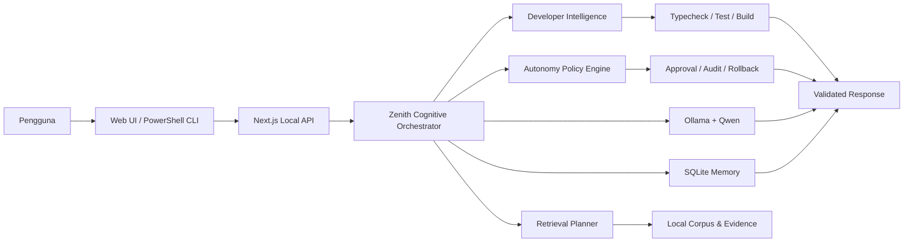

<div align="center">
  

  <br />

  
  
  
  
  
  

  <h3>Asisten AI lokal seimbang dengan controlled coding agent, verifikasi berlapis, dan deployment preview/staging.</h3>

  <p>
    <strong>Ollama + Qwen</strong> • <strong>Next.js</strong> • <strong>FastAPI ML Service</strong> •
    <strong>Web lokal</strong> • <strong>PowerShell CLI</strong> • <strong>Bahasa Indonesia</strong>
  </p>
</div>

---

## Tentang NusaMind Zenith

**NusaMind Zenith N1.2** adalah edisi seimbang dari keluarga NusaMind AI. Zenith menggabungkan reasoning yang lebih mendalam dengan controlled build, exact patch, checkpoint, rollback, Git workflow terverifikasi, credential vault, trusted workspace, MCP quarantine, serta deployment preview dan staging.

Release **N1.2 / 1.2.0** melanjutkan fondasi N1.0 dengan **Developer Intelligence N1.1** dan **Advanced Autonomy & Deployment N1.2**. Implementasi ditulis ulang untuk arsitektur NusaMind dan tidak menyalin source OpenCode secara mentah.

> NusaMind AI dikembangkan oleh **Muhammad Rafi Priyo** sebagai proyek AI lokal, eksperimen engineering, dan portofolio pribadi. Tidak semua komponen dibuat oleh AI; sebagian dirancang, dikembangkan, diuji, diperbaiki, dan disempurnakan secara manual oleh developer.

## Karakteristik Zenith

- **Seimbang:** reasoning, resource, dan kemampuan engineering berada di tengah antara Swift dan Apex.
- **Controlled build:** edit, exact patch, test, build, checkpoint, dan rollback melalui approval serta policy engine.
- **Bounded autonomy:** maksimal 40 langkah, soft limit 20, runtime 90 menit, dan paralelisme maksimal 2.
- **Verified Git workflow:** push normal dan force-with-lease melalui secret scan, verification evidence, serta remote backup.
- **Preview dan staging deployment:** production deployment tetap tidak tersedia pada Zenith.
- **Local-first:** Ollama, memory, corpus, dan layanan utama berjalan lokal.
- **Web + CLI:** dapat digunakan melalui browser lokal atau PowerShell CLI.

## Developer Intelligence N1.1

- Mode `ASK`, `PLAN`, `BUILD`, `REVIEW`, dan `REPAIR`.
- Project scanner, project map, context ranking, dependency tracing, dan selective LSP.
- Exact patch, checkpoint, rollback, typecheck, test, dan build verification.
- Permission engine per tool/path/agent serta destructive-action gate.
- Maksimal tiga skill dan dua pekerjaan analisis paralel.
- Edit, commit, push, credential, dan deployment tetap tunduk pada approval serta policy.

## Advanced Autonomy & Deployment N1.2

Zenith mengaktifkan autonomy terkontrol untuk development dan staging:

- Git push normal setelah verification dan secret scan.
- Force push hanya memakai `--force-with-lease` dan remote backup branch.
- Controlled destructive action melalui typed action, preview, backup, dan approval.
- Encrypted credential vault dengan reference yang tidak memaparkan nilai secret ke model.
- Trusted external workspace read-write setelah registrasi.
- Unverified MCP tetap quarantine dan hanya dapat berjalan melalui sandbox wrapper.
- Deployment tersedia untuk `preview` dan `staging`; production tetap Apex-only.
- Extended loop maksimal 40 langkah dengan emergency ceiling dan `.nusamind/STOP`.

## Fitur Utama

### Cognitive Runtime

- Unified Cognitive Orchestrator.
- Adaptive Reasoning Portfolio edisi Zenith.
- Claim ledger dan Evidence Graph V2.
- Uncertainty, abstention, dan escalation policy.
- Resource budget khusus edisi Zenith.

### Retrieval, Memory, dan File Analysis

- Retrieval Planner N1 dan domain routing.
- Evidence-preserving retrieval dan source snapshot.
- Privacy-aware memory serta SQLite local session.
- Dataset lineage dan transformation ledger.
- PDF, DOCX, XLSX, CSV, TXT, dan gambar.
- Python FastAPI ML Service dengan confidence dan fallback policy.

### Defensive Cybersecurity

- Defensive Security Project Registry.
- Authorization dan scope validation.
- Secret redaction serta prompt-injection defensive policy.
- Analisis log, phishing, URL, SIEM, dan traffic untuk penggunaan defensif.

> NusaMind tidak ditujukan untuk autonomous hacking, credential capture, malware execution, evasion, eksploitasi target eksternal, atau pemindaian publik tanpa izin.

## Arsitektur



## Persyaratan

- Windows 10 atau Windows 11.
- Node.js **22 atau lebih baru**.
- npm, Python 3, Ollama, dan PowerShell.
- RAM minimal yang disarankan: **16 GB**.
- Storage yang cukup untuk model Ollama dan corpus lokal.

## Instalasi

```powershell
git clone https://github.com/muhrafi-fsdev/NUSAMIND-ZENITH.git
cd NUSAMIND-ZENITH
Copy-Item .env.example .env
.\ollama.bat
.\ml-setup.bat
.\dev.bat
```

Buka `http://localhost:3000`.

## Menjalankan Harian

Gunakan terminal terpisah:

```powershell
ollama serve
.\ml-start.bat
.\dev.bat
.\run-cli.bat
```

Untuk coding assistant dan autonomy CLI:

```powershell
.\code.bat
.\autonomy.bat
```

Zenith mendukung controlled build dan repair. Seluruh tindakan sensitif harus melewati approval, policy, checkpoint, secret scan, serta verification evidence.

## API N1

- `GET /api/n1/status`
- `GET /api/n1/evaluate`
- `POST /api/n1/orchestrate`
- `GET /api/n1/developer`
- `POST /api/n1/developer`
- `GET /api/n1/autonomy`
- `POST /api/n1/autonomy`
- Stable adapters: `/api/core/status` dan `/api/core/evaluate`

## Script Penting

| Perintah | Fungsi |
|---|---|
| `.\ollama.bat` | Menyiapkan model Qwen pada Ollama |
| `.\ml-setup.bat` | Membuat environment ML |
| `.\ml-start.bat` | Menjalankan FastAPI ML Service |
| `.\dev.bat` | Menjalankan backend dan Web UI |
| `.\run-cli.bat` | Menjalankan CLI utama |
| `.\code.bat` | Menjalankan coding assistant |
| `.\autonomy.bat` | Membuka autonomy CLI Zenith untuk Git, vault, workspace, MCP, dan staging |
| `npm run check` | TypeScript validation |
| `npm run build` | Production build |
| `npm run gate` | N1 release gate |
| `npm run developer:benchmark` | Benchmark Developer Intelligence |
| `npm run autonomy:benchmark` | Benchmark policy N1.2 |

## Konfigurasi Autonomy

Buat `.env` dari `.env.example`, lalu ganti seluruh token default. Batas edisi ini adalah maksimal **40 langkah** autonomy. Nilai credential tidak boleh ditulis langsung di source atau README.

```env
AUTONOMY_AGENT_TOKEN=ganti-dengan-token-panjang-acak
NUSAMIND_VAULT_KEY=ganti-dengan-base64-key-32-byte
NUSAMIND_RAW_SHELL=false
NUSAMIND_FORCE_PUSH_MODE=force-with-lease
NUSAMIND_MCP_QUARANTINE=true
NUSAMIND_DEPLOYMENT_ROLLBACK=true
```

## Validasi Release

```powershell
npm ci
npm run check
npm run build
npm run gate
npm run developer:benchmark
npm run autonomy:benchmark
```

Jangan menyatakan deployment atau build berhasil tanpa output verifikasi nyata dari mesin yang menjalankannya.

## Batasan dan Keamanan

- Zenith tidak mengizinkan autonomous production deployment.
- Raw arbitrary shell tetap nonaktif; destructive action harus memakai typed controlled action.
- Semua force push menggunakan `--force-with-lease` dan remote backup.
- Windows EXE/Electron dibatalkan dan n8n masih ditunda.
- Main UI tidak diubah pada update N1.2.
- Jangan commit `.env`, token, private key, database runtime, session, atau credential vault.
- Jangan membuka endpoint autonomy langsung ke internet tanpa autentikasi, firewall, dan reverse proxy.
- Kualitas reasoning tetap bergantung pada model, prompt, data, tool, dan hardware.

Dokumentasi penting:

- [`AGENTS.md`](AGENTS.md)
- [`UPGRADE_REPORT.md`](UPGRADE_REPORT.md)
- [`docs/autonomy-n1.2.md`](docs/autonomy-n1.2.md)
- [`data/release/n1.2/manifest.json`](data/release/n1.2/manifest.json)

## Status Lisensi

Repository ini belum menetapkan lisensi open-source. Visibilitas publik di GitHub tidak otomatis memberikan izin untuk menyalin, memodifikasi, atau mendistribusikan ulang source code.

## Developer

<div align="center">
  <strong>Muhammad Rafi Priyo</strong><br />
  Junior Full-Stack Developer • Local AI & Software Engineering Enthusiast
</div>

---

<div align="center">
  <sub>NusaMind AI Zenith N1.2 — Local Intelligence, Controlled Autonomy</sub>
</div>
