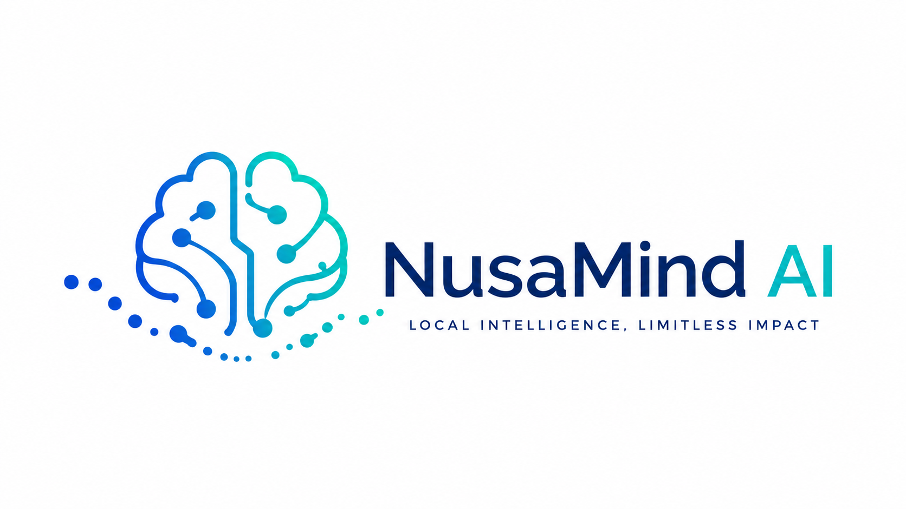
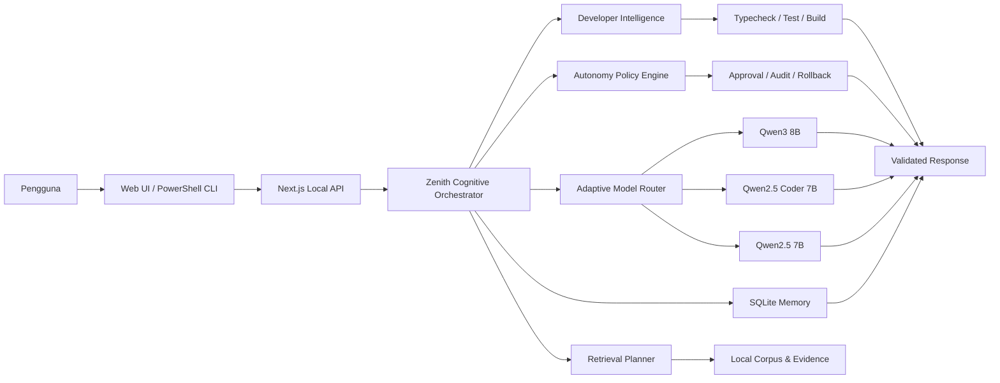

<div align="center">
  

  <br />

  
  
  
  
  
  

  <h3>Asisten AI lokal seimbang dengan Qwen3 adaptif, jawaban akademik terstruktur, controlled coding agent, dan deployment preview/staging.</h3>

  <p>
    <strong>Ollama + Qwen3</strong> • <strong>Next.js</strong> • <strong>FastAPI ML Service</strong> •
    <strong>Web lokal</strong> • <strong>PowerShell CLI</strong> • <strong>Bahasa Indonesia</strong>
  </p>
</div>

---

## Tentang NusaMind Zenith

**NusaMind Zenith N1.4.1** adalah edisi seimbang dari keluarga NusaMind AI. Zenith menggabungkan reasoning adaptif, kualitas jawaban akademik, controlled build, exact patch, checkpoint, rollback, Git workflow terverifikasi, credential vault, trusted workspace, MCP quarantine, serta deployment preview dan staging.

Release **N1.4.1 / 1.4.1** melanjutkan fondasi N1.0 dengan **Developer Intelligence N1.1**, **Advanced Autonomy & Deployment N1.2**, **Answer Quality & Academic Response Engine N1.3**, serta **Adaptive Qwen3 Model Runtime N1.4**.

> NusaMind AI dikembangkan oleh **Muhammad Rafi Priyo** sebagai proyek AI lokal, eksperimen engineering, dan portofolio pribadi. Tidak semua komponen dibuat oleh AI; sebagian dirancang, dikembangkan, diuji, diperbaiki, dan disempurnakan secara manual oleh developer.

## Karakteristik Zenith

- **Seimbang:** reasoning, resource, kualitas jawaban, dan kemampuan engineering berada di tengah antara Swift dan Apex.
- **Adaptive Qwen3:** model utama `qwen3:8b`, model coding `qwen2.5-coder:7b`, dan fallback `qwen2.5:7b`.
- **Thinking adaptif:** aktif pada tugas menengah hingga berat, tetapi tidak dipaksakan untuk pertanyaan sederhana.
- **Controlled build:** edit, exact patch, test, build, checkpoint, dan rollback melalui approval serta policy engine.
- **Bounded autonomy:** maksimal 40 langkah, soft limit 20, runtime 90 menit, dan paralelisme maksimal 2.
- **Preview dan staging deployment:** production deployment tetap tidak tersedia pada Zenith.
- **Local-first:** Ollama, memory, corpus, dan layanan utama berjalan lokal.
- **Web + CLI:** dapat digunakan melalui browser lokal atau PowerShell CLI.

## Developer Intelligence N1.1

- Mode `ASK`, `PLAN`, `BUILD`, `REVIEW`, dan `REPAIR`.
- Project scanner, project map, context ranking, dependency tracing, dan selective LSP.
- Exact patch, checkpoint, rollback, typecheck, test, dan build verification.
- Permission engine per tool/path/agent serta destructive-action gate.
- Maksimal tiga skill dan dua pekerjaan analisis paralel.
- Edit, commit, push, credential, dan deployment tetap tunduk pada approval serta policy.

## Advanced Autonomy & Deployment N1.2

Zenith mengaktifkan autonomy terkontrol untuk development dan staging:

- Git push normal setelah verification dan secret scan.
- Force push hanya memakai `--force-with-lease` dan remote backup branch.
- Controlled destructive action melalui typed action, preview, backup, dan approval.
- Encrypted credential vault dengan reference yang tidak memaparkan nilai secret ke model.
- Trusted external workspace read-write setelah registrasi.
- Unverified MCP tetap quarantine dan hanya dapat berjalan melalui sandbox wrapper.
- Deployment tersedia untuk `preview` dan `staging`; production tetap Apex-only.
- Extended loop maksimal 40 langkah dengan emergency ceiling dan `.nusamind/STOP`.

## Answer Quality & Academic Response Engine N1.3

- Jawaban matematika, fisika, kimia, statistika, dan perhitungan mengikuti urutan **Diketahui → Konsep/Rumus → Penyelesaian → Jawaban akhir → Penjelasan singkat**.
- Jawaban coding memakai tujuan solusi, kode lengkap, cara kerja, contoh input/output, serta edge case ketika relevan.
- Hasil akhir dibuat tegas, tidak berulang, dan tidak menghilangkan langkah penting.
- Code block dijaga tetap utuh dan diberi label bahasa yang sesuai.
- Kedalaman jawaban menyesuaikan pertanyaan dan mode `direct`, `balanced`, `steps`, `detailed`, `academic`, atau `expert`.
- Batas output default Zenith dinaikkan menjadi sekitar **5.200 token**.

## Suite Knowledge & Evaluation Map N1.4.2

- Pengetahuan tujuh suite evaluasi: Agentic (18), Reasoning (202), Coding (29), Browser Use (25), Data Analysis (150), Research (22), dan Design (25).
- Aturan skor tersedia sebagai data dan sebagai kode: task tidak terukur bernilai 0, overall adalah rata-rata suite yang punya skor, dan biaya per task dihitung dari total.
- Peta kemampuan Zenith per suite berasal dari audit kode, bukan benchmark. **Benchmark live: `NOT_RUN`, tidak ada skor yang diklaim.**
- Browser Use dan Design saat ini `NOT_SUPPORTED` (tidak ada jalur screenshot dan tidak ada penghasil DOCX/PDF/PPTX).
- Sumber taksonomi diberikan pengembang dan belum diverifikasi; rincian di [`docs/benchmark-suites-n1.4.2.md`](docs/benchmark-suites-n1.4.2.md).
- Tidak mengubah UI, model Qwen, atau perilaku jawaban.

## Native TypeScript 7 Engineering Patch N1.4.1

- TypeScript 7 native dijadikan jalur pemeriksaan utama untuk diagnostic dan typecheck.
- Pemeriksaan kompatibilitas tetap tersedia melalui `npm run check:legacy`.
- Pemeriksaan dua jalur tersedia melalui `npm run check:dual`.
- Script `typescript-setup.bat` menyiapkan dependency dan benchmark migrasi.
- Patch ini tidak mengubah model Qwen, batas output token, UI, ML Service, maupun kebijakan autonomy.
- `package-lock.json` lama dihapus karena masih mengunci TypeScript 5; jalankan `npm install` untuk membuat lockfile N1.4.1 yang sesuai.

## Adaptive Qwen3 Model Runtime N1.4

- Model utama Zenith dinaikkan menjadi `qwen3:8b`.
- Jalur coding tetap memakai `qwen2.5-coder:7b` untuk stabilitas.
- Fallback otomatis menggunakan `qwen2.5:7b` jika model utama tidak tersedia.
- Thinking mode diaktifkan secara adaptif berdasarkan kesulitan tugas.
- Runtime memeriksa model yang terpasang sebelum melakukan routing.
- Context budget dibuat realistis agar tidak langsung membebani RAM dan VRAM.
- Header respons menyediakan informasi model, jalur routing, fallback, dan status thinking.

## Fitur Utama

### Cognitive Runtime

- Unified Cognitive Orchestrator.
- Adaptive Reasoning Portfolio edisi Zenith.
- Claim ledger dan Evidence Graph V2.
- Uncertainty, abstention, dan escalation policy.
- Resource budget khusus edisi Zenith.

### Retrieval, Memory, dan File Analysis

- Retrieval Planner N1 dan domain routing.
- Evidence-preserving retrieval dan source snapshot.
- Privacy-aware memory serta SQLite local session.
- Dataset lineage dan transformation ledger.
- PDF, DOCX, XLSX, CSV, TXT, dan gambar.
- Python FastAPI ML Service dengan confidence dan fallback policy.

### Defensive Cybersecurity

- Defensive Security Project Registry.
- Authorization dan scope validation.
- Secret redaction serta prompt-injection defensive policy.
- Analisis log, phishing, URL, SIEM, dan traffic untuk penggunaan defensif.

> NusaMind tidak ditujukan untuk autonomous hacking, credential capture, malware execution, evasion, eksploitasi target eksternal, atau pemindaian publik tanpa izin.

## Arsitektur



## Persyaratan

- Windows 10 atau Windows 11.
- Node.js **22 atau lebih baru**.
- npm, Python 3, Ollama, dan PowerShell.
- RAM minimal yang disarankan: **16 GB**.
- Storage yang cukup untuk model Ollama dan corpus lokal.

## Instalasi

```powershell
git clone https://github.com/muhrafi-fsdev/NUSAMIND-ZENITH.git
cd NUSAMIND-ZENITH
Copy-Item .env.example .env
.\ollama.bat
.\ml-setup.bat
.\dev.bat
```

Buka `http://localhost:3000`.

## Menjalankan Harian

Gunakan terminal terpisah:

```powershell
ollama serve
.\ml-start.bat
.\dev.bat
.\run-cli.bat
```

Untuk coding assistant dan autonomy CLI:

```powershell
.\code.bat
.\autonomy.bat
```

## API N1

- `GET /api/n1/status`
- `GET /api/n1/evaluate`
- `POST /api/n1/orchestrate`
- `GET /api/n1/developer`
- `POST /api/n1/developer`
- `GET /api/n1/autonomy`
- `POST /api/n1/autonomy`
- Stable adapters: `/api/core/status` dan `/api/core/evaluate`

## Script Penting

| Perintah | Fungsi |
|---|---|
| `.\ollama.bat` | Menyiapkan Qwen3 8B, model coding, dan fallback pada Ollama |
| `.\ml-setup.bat` | Membuat environment ML |
| `.\ml-start.bat` | Menjalankan FastAPI ML Service |
| `.\dev.bat` | Menjalankan backend dan Web UI |
| `.\run-cli.bat` | Menjalankan CLI utama |
| `.\code.bat` | Menjalankan coding assistant |
| `.\autonomy.bat` | Membuka autonomy CLI Zenith |
| `npm run answer:benchmark` | Benchmark kualitas jawaban N1.3 |
| `npm run model:n14:benchmark` | Benchmark Adaptive Qwen3 Runtime N1.4 |
| `npm run model:n14:status:live` | Memeriksa status model Ollama secara langsung |
| `npm run suites:n142:status` | Ringkasan tujuh suite dan status kemampuan Zenith |
| `npm run suites:n142:benchmark` | Validasi data suite dan aturan skor N1.4.2 |
| `npm run developer:benchmark` | Benchmark Developer Intelligence |
| `npm run autonomy:benchmark` | Benchmark policy autonomy |
| `npm run check` | TypeScript validation |
| `npm run build` | Production build |
| `npm run gate` | Release gate |

## Konfigurasi Model

```env
OLLAMA_MODEL=qwen3:8b
OLLAMA_CODER_MODEL=qwen2.5-coder:7b
OLLAMA_FALLBACK_MODEL=qwen2.5:7b
AI_MAX_OUTPUT_TOKENS=5200
NUSAMIND_THINKING_MODE=adaptive
NUSAMIND_RELEASE=N1.4
```

## Konfigurasi Autonomy

Buat `.env` dari `.env.example`, lalu ganti seluruh token default.

```env
AUTONOMY_AGENT_TOKEN=ganti-dengan-token-panjang-acak
NUSAMIND_VAULT_KEY=ganti-dengan-base64-key-32-byte
NUSAMIND_RAW_SHELL=false
NUSAMIND_FORCE_PUSH_MODE=force-with-lease
NUSAMIND_MCP_QUARANTINE=true
NUSAMIND_DEPLOYMENT_ROLLBACK=true
```

## Validasi Release

```powershell
npm ci
npm run answer:benchmark
npm run model:n14:benchmark
npm run model:n14:status:live
npm run check
npm run build
npm run gate
npm run developer:benchmark
npm run autonomy:benchmark
```

Jangan menyatakan deployment, build, atau model runtime berhasil tanpa output verifikasi nyata dari mesin yang menjalankannya.

## Batasan dan Keamanan

- Zenith tidak mengizinkan autonomous production deployment.
- Raw arbitrary shell tetap nonaktif; destructive action harus memakai typed controlled action.
- Semua force push menggunakan `--force-with-lease` dan remote backup.
- Qwen3 Coder 30B tidak menjadi default Zenith.
- Windows EXE/Electron dibatalkan dan n8n masih ditunda.
- Main UI tidak diubah pada update N1.1 sampai N1.4.
- Jangan commit `.env`, token, private key, database runtime, session, atau credential vault.
- Jangan membuka endpoint autonomy langsung ke internet tanpa autentikasi, firewall, dan reverse proxy.
- Kualitas reasoning tetap bergantung pada model, prompt, data, tool, context, dan hardware.

Dokumentasi penting:

- [`AGENTS.md`](AGENTS.md)
- [`UPGRADE_REPORT.md`](UPGRADE_REPORT.md)
- [`docs/autonomy-n1.2.md`](docs/autonomy-n1.2.md)
- [`docs/answer-quality-n1.3.md`](docs/answer-quality-n1.3.md)
- [`docs/model-runtime-n1.4.md`](docs/model-runtime-n1.4.md)
- [`docs/benchmark-suites-n1.4.2.md`](docs/benchmark-suites-n1.4.2.md)
- [`data/release/n1.2/manifest.json`](data/release/n1.2/manifest.json)

## Status Lisensi

Repository ini belum menetapkan lisensi open-source. Visibilitas publik di GitHub tidak otomatis memberikan izin untuk menyalin, memodifikasi, atau mendistribusikan ulang source code.

## Developer

<div align="center">
  <strong>Muhammad Rafi Priyo</strong><br />
  Junior Full-Stack Developer • Local AI & Software Engineering Enthusiast
</div>

---

<div align="center">
  <sub>NusaMind AI Zenith N1.4.2 — Adaptive Intelligence, Controlled Engineering</sub>
</div>
