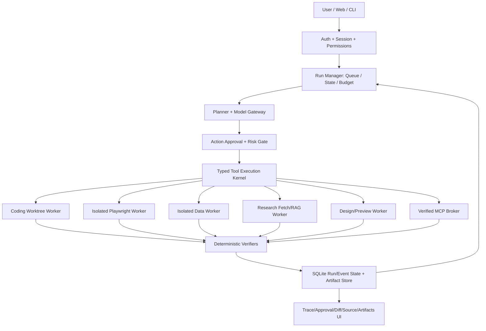

# Target Architecture & Phased Rollout

## 1. Design principles

**Adopt before rewrite.** Existing N1.4.1 code is the foundation. Every new service must reuse existing policies, typed tool definitions, retrieval, evidence and model routing where safe. Avoid 6 independent engines with separate auth, permission, memory and logging.

**Single execution truth.** UI/CLI call unified Run API. All capabilities pass through policy and tool kernel; no direct browser/coding/MCP access bypasses auth. Model is a planner and analyst, never a trusted authority for executing sensitive actions.



## 2. Modules to implement or adapt (proposed paths, not guaranteed existing)

| Capability | Reuse | Proposed target |
| --- | --- | --- |
| Kernel | `lib/agent-runtime/*`, `lib/tool-runtime/contracts.ts`, `packages/autonomy-engine` | `lib/agent-runtime/{run-manager,tool-kernel,approval-store,verification,events}.ts` |
| API | `/api/n1/*`, `/api/coding`, main chat | `app/api/workbench/runs`, `/runs/[id]`, `/runs/[id]/events`, `/runs/[id]/approve`, `/runs/[id]/cancel` |
| Coding | `lib/coding-agent.ts`, `packages/developer-intelligence` | `lib/workers/coding/` with worktrees and fixtures |
| Browser | `packages/browser-operator`, `app/api/v9/browser` | `lib/workers/browser/`, Playwright worker, egress policy |
| Data | `lib/file-analyzer.ts`, ML Service | `lib/workers/data/`, `ml-service/analysis_worker/` optional |
| Research | `lib/retrieval-v6.ts`, `lib/research/registry.ts` | `lib/workers/research/`, source ledger + adapters |
| Design | `components/ChatShell.tsx` + app shell | `components/workbench/`, `lib/workers/design/` |
| Persistent state | Existing SQLite/session store | versioned N2 run tables, migration and rollback |
| QA | `scripts/eval-*.mjs`, release gate | `tests/n2/` with unit/integration/E2E/security |

### Route shape (illustrative)

```json
POST /api/workbench/runs
{
  "goal": "Perbaiki bug fixture TypeScript dan jalankan tes",
  "capability": "coding",
  "mode": "PLAN",
  "workspaceId": "registered-workspace-id",
  "budget": { "maxSteps": 10, "maxRuntimeMs": 1800000 }
}

GET /api/workbench/runs/{id}
GET /api/workbench/runs/{id}/events
POST /api/workbench/runs/{id}/approve
POST /api/workbench/runs/{id}/cancel
```

Avoid allow-the-model-to-post arbitrary workspace/command paths. Workspace ID must be preregistered by the application owner, not resolved from arbitrary JSON.

## 3. Phases & PR splits

| Phase | PR boundary | Deliverable | Gate |
| --- | --- | --- | --- |
| 0A | Build reproducibility | Lockfile, lint, CI, real test runner, baseline docs | cold npm ci / check / lint / build (when possible) |
| 0B | Security | Secure mutating endpoints, approval store, MCP sandbox, secret redaction | P0-04 through P0-14 security tests |
| 1A | Core orchestrator | Run state machine, tool kernel, events, cancellation, verification | A-01 to A-06 |
| 1B | Coding | worktree patch/verify/rollback, UI diff | C-01 to C-05 |
| 2 | Browser | isolated Playwright, anti-SSRF, screenshots, trace, approvals | B-01 to B-07 |
| 3A | Research | grounded retrieval, optional live search, source registry | R-01 to R-05 |
| 3B | Data | sandboxed deterministic analysis, chart and CSV exports | D-01 to D-05 |
| 4 | Design + Workbench UX | editable component artifacts, preview, tokens, a11y | U-01 to U-06 |
| 5 | Release hardening | bench comparisons, docs, Windows smoke, rollback guide | overall release matrix |

**Dependency order:** security before network or code execution; unified kernel before browser/data/design; E2E & regression before declaring release.

## 4. Skill / role selection for Codex

Prefer installed capabilities when truly available; do not pretend to invoke unavailable MCP servers:
- **Architect:** repository explorer / code search / dependency auditing / ADR writing.
- **Security:** auth threat model / SSRF / command sandbox / secrets & prompt injection.
- **Full-stack:** Next.js 16 App Router, TypeScript, React 19, SDK tool calling.
- **Browser QA:** Playwright E2E / traces / screenshots.
- **Data:** Python test fixtures, deterministic Pandas stats, export verification.
- **Research:** source provenance, multi-source synthesis and citation checking.
- **Design:** design system, web UI implementation, accessibility and responsive screenshots.
- **DevOps:** GitHub Actions, PowerShell Windows smoke, version/rollout/docs.

At most 2 parallel **read-only** subagents in Zenith, if Codex environment supports them. Avoid adding untrusted MCP/skills with shell tools just to inflate capabilities.

## 5. Backward compatibility & rollbacks

- Existing `/api/chat`, `/api/n1/*`, `/api/coding` remain available under prior contracts or documented compatibility facade.
- Old N1 data, session storage, model selection, script names and edition constraints retained.
- Feature flags guard new capabilities; migrations must be additive, forward/rollback documented.
- Reversible code changes in isolated branch/worktree, no database deletion or automatic production deploy.
- Release process: tag RC only after verifying built artifact; merge by owner after review.

## 6. Resource profile & budget control

Default local profile targets 16GB RAM:
- Ollama primary qwen3:8b; fallback if unavailable; no forced 30B model download.
- Playwright Chromium only on browser-demand; ensure browser contexts are closed.
- Python isolated data worker started on task and exited; cap time/file size/memory where supported.
- Do not concurrently start heavyweight local ML, multiple LLMs, Chromium browsers and data workers without measuring resource budget.
- Degrade gracefully with capability status and setup guidance; never fabricate external capabilities.

## 7. Codex handoff process

1. Create branch, reproduce tests, fix P0 first.
2. Every PR includes limited scope and precise migration notes.
3. Never merge while critical tests missing or failing.
4. Update PRD checkboxes and `TEST_EVIDENCE` based on actual tests.
5. When branch passes gates, request human review and retain user approval before merge/deploy.
